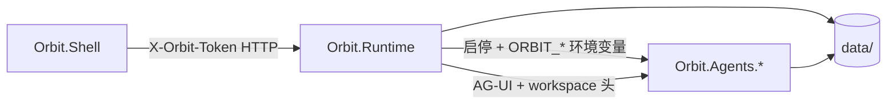
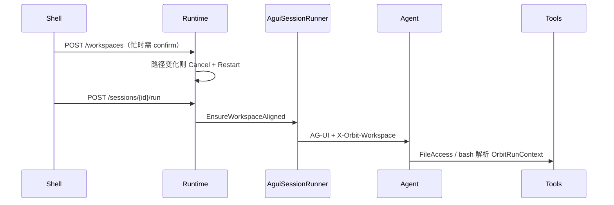
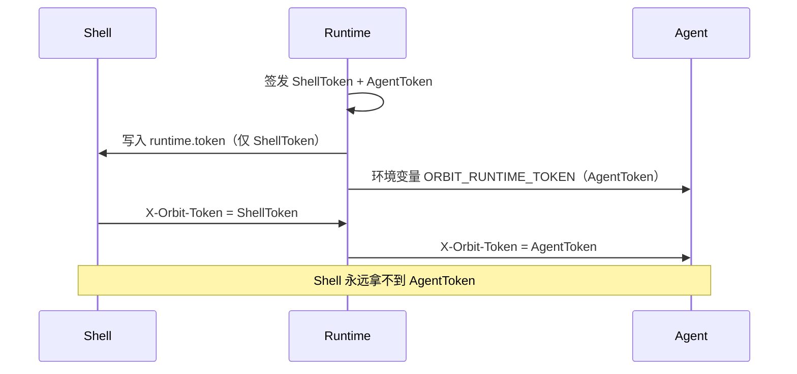

# Orbit 架构

[English](architecture.md) · 版本 **0.0.1**  
各助手能力（Skills / 压缩 / 记忆 / HITL 等）：[agents-zh.md](agents-zh.md)

## 进程模型

- **Orbit.Runtime**：常驻真相源（注册表、进程监督、会话、工作区、MCP 配置文件）。
- **Orbit.Agents.\***：一助手一进程；进程内 ASP.NET；先 `/health`，后 AG-UI。
- **Orbit.Shell / 未来 Web / CLI**：薄客户端，不拥有会话真相。

Agent 进程 **WorkingDirectory** 仍为 exe 目录。工作区通过环境变量 / 每轮请求头注入，不改宿主 cwd（避免弄坏 ASP.NET ContentRoot）。

## 发现

`agents/*.json` → 内存注册表 → 客户端只调 `GET /agents`。

清单字段：

- `workspace`：`required` | `optional` | `none`（默认 `optional`）。
- `harness`：启动时写入 `ORBIT_HARNESS`。可选：`mode` / `todo` / `skills` / `file_access` / `file_memory` / `background` / `compaction` / `tool_approval`。空 → `mode,todo,skills,compaction,tool_approval`。磁盘类与 Background 仍需显式 opt-in。

## 会话树

`data/sessions/{sessionId}.jsonl` — header + entry（`id` / `parentId` / `type` / `payload`）。

`POST /sessions/{id}/run` 时 Runtime 用 `AGUIChatClient` 连助手 `/ag-ui`，写入：

- `user` / `assistant` / `thinking`
- `tool_call` / `tool_result`
- `meta`（run started/finished、interrupted 等）
- `error` / 审批条目

### 增量同步 + SSE

| 路由 | 作用 |
|------|------|
| `GET /sessions/{id}` | 完整 `SessionDetail` |
| `GET /sessions/{id}?after={entryId}` | `SessionSyncResponse`：游标之后的条目；`after` 缺省/未知/过期时 `fullSnapshot: true` |
| `GET /sessions/{id}/events?after=` | SSE：`event: sync` 同上；心跳 `event: ping` 独立约 12s；轮询约 300ms |

Shell 在一轮 turn 期间订阅 `/events`，用 `SessionEntrySync` 合并，turn 结束取消。鉴权仍走 `X-Orbit-Token`（中间件）。

## 日志

Serilog 滚动文件：`%LOCALAPPDATA%/Orbit/logs/` — `runtime-*.log`、`agent-{id}-*.log`、`shell-*.log`（同目录，保留 14 天）。可能含对话/工具参数——见 [SECURITY.md](../SECURITY.md)。

## AG-UI

- 助手：`MapAGUIHost("/ag-ui", agent)`
- 产品路径上只有 Runtime 调助手端口（Shell 不直连），便于以后换 Avalonia / Web / CLI。

每轮 Runtime 设置：

| Header | 用途 |
|--------|------|
| `X-Orbit-Token` | 须与 Agent 的 `ORBIT_RUNTIME_TOKEN` 一致 |
| `X-Orbit-Run-Id` | 遥测隔离 |
| `X-Orbit-Session-Id` | 会话关联 |
| `X-Orbit-Workspace` / `-Id` | 会话快照 → `OrbitRunContext` |

## Workspace

- 注册表：`data/workspaces.json`（原子写）；单一 `activeId`。
- 会话创建快照 `WorkspaceId` / `WorkspacePath`（之后不可变）。
- Run 守卫：policy ≠ `none` 且会话路径 ≠ `StartedWorkspacePath` → `409 workspace_mismatch`。
- 切换：目标 Agent 有 in-flight 且未 `confirm` → `409 confirm_required`；Shell 确认后带 `confirm=true` 重试。
- 工具：`OrbitWorkspaceAgentFileStore` / Coder bash 按 `OrbitRunContext.Workspace` → env → 回退。
- Workspace Open：`RejectUnsafeRoots` 对 symlink/junction **最终目标**再校验一次（`ResolveLinkTarget`）。
- **MCP stdio cwd** 仍是进程创建时的 `ORBIT_WORKSPACE`（不是 per-run `OrbitRunContext`）；靠重启 Agent 刷新。

## 本机鉴权

1. Runtime 启动写入 `%LOCALAPPDATA%/Orbit/runtime.token`（pid 认领，防双开）。
2. 除 `GET /health` 外，Runtime HTTP 需 Shell 的 `X-Orbit-Token`；Agent 进程使用内存中的另一枚 Agent token。
3. Supervisor 向 Agent 注入 `ORBIT_RUNTIME_TOKEN`（Agent token）。
4. Agent 中间件校验 token（`/health` 除外，并报告 `authRequired`）。
5. API 错误体统一为 `{ "code", "message", "details?" }`（`OrbitApiError` / `OrbitErrorCodes`）。

仅绑定 `127.0.0.1` 不是信任边界；token 才是。

## LLM 设置

- 落盘：`%LOCALAPPDATA%/Orbit/llm.settings.json`；Key 用 DPAPI（CurrentUser）加密；注入 Agent 的进程环境变量仅为**当前** profile 明文。
- 上下文窗口：`OrbitLlmContextWindow`（Shell 仪表 / Hosting 压缩 / Runtime history 共用）。
- `/llm/models`：调用方 endpoint 与已存不一致时必须显式带 Key。

## Workspace 策略

- `OrbitWorkspacePolicy`；reparse 解析失败 **fail-closed**。
- agentId：`OrbitPathNames.IsSafeAgentId`。

## Harness 目录

- `HarnessToolCatalog` 与框架 `*ToolName` 对齐；无 children 时不挂 background stub。

## Playwright

- 共享库 `Orbit.Agents.Browser`：只管 Chromium 生命周期与 profile 目录（`data/browser-profiles/{agentId}/{profileId}/`）。
- 不含 Agent 领域逻辑（如邮箱注册表在 `Orbit.Agents.Mail`）。
- 工具：`open_login_page` / `get_browser_status` / `wait_for_url_change`
- 登录在真实窗口完成；Runtime 只把工具结果写入会话树

## MCP

- Agent 启动时加载（`McpToolHost`）；本版无热插拔。
- 配置：`data/mcp/{agentId}.json`；信任门（`trusted` 默认 false）。
- 审计：`data/audit/mcp.jsonl`。

## 文档语言

- 架构 / 助手能力 / README：中英各一份。
- C# 注释 / XML：仅英文。
- Shell UI：`strings.zh.json` / `strings.en.json`。
