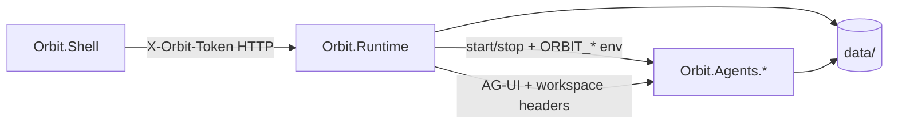
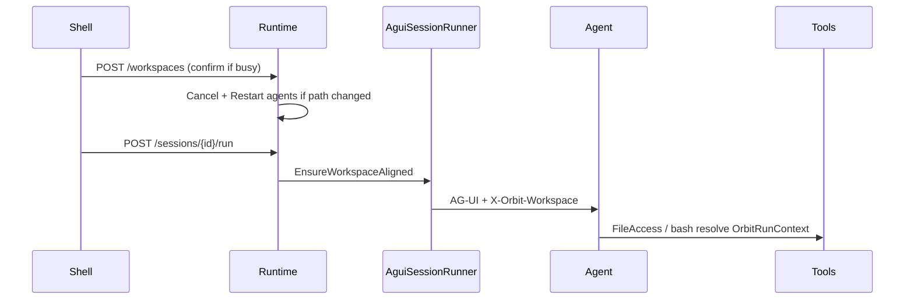
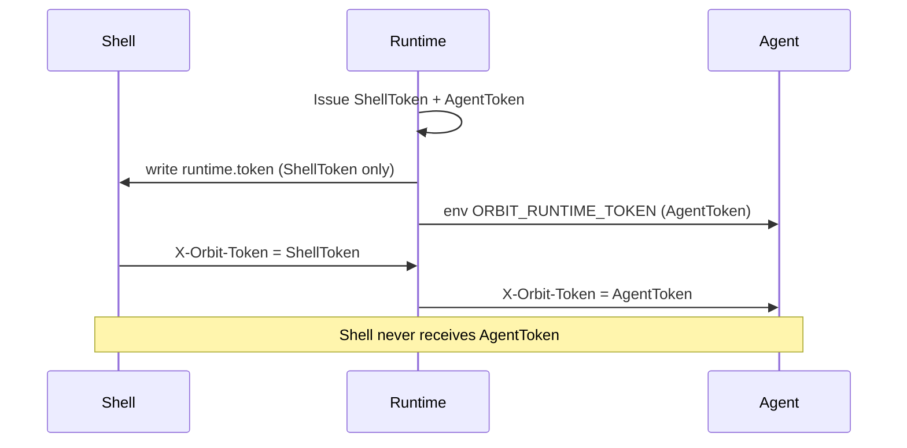

# Orbit architecture

[中文版](architecture-zh.md) · Version **0.0.1**  
Per-agent capabilities (skills / compaction / memory / HITL): [agents.md](agents.md)

## Process model

- **Orbit.Runtime**: long-lived source of truth (registry, supervisor, sessions, workspaces, MCP config files).
- **Orbit.Agents.\***: one process per assistant; ASP.NET in-process; `/health` then AG-UI.
- **Orbit.Shell / future Web / CLI**: thin clients; they do not own session truth.

Agent process **WorkingDirectory** stays the exe folder. Workspace is injected via env / per-run headers, not by changing the host cwd (avoids breaking ASP.NET ContentRoot).

## Discovery

`agents/*.json` → in-memory registry → clients call `GET /agents` only.

Manifest fields:

- `workspace`: `required` | `optional` | `none` (default `optional`).
- `harness`: CSV-equivalent list → Runtime sets `ORBIT_HARNESS` on agent start. Selectable: `mode` / `todo` / `skills` / `file_access` / `file_memory` / `background` / `compaction` / `tool_approval`. Empty → `mode,todo,skills,compaction,tool_approval`. Disk providers and Background still require explicit opt-in.

## Session tree

`data/sessions/{sessionId}.jsonl` — header + entry lines (`id` / `parentId` / `type` / `payload`).

On `POST /sessions/{id}/run`, Runtime uses `AGUIChatClient` against the agent `/ag-ui` and appends:

- `user` / `assistant` / `thinking`
- `tool_call` / `tool_result`
- `meta` (run started/finished, interrupted, …)
- `error` / approval entries

### Incremental sync + SSE

| Route | Role |
|-------|------|
| `GET /sessions/{id}` | Full `SessionDetail` |
| `GET /sessions/{id}?after={entryId}` | `SessionSyncResponse`: entries **after** the cursor; `fullSnapshot: true` when `after` is omitted/unknown/stale |
| `GET /sessions/{id}/events?after=` | SSE stream: `event: sync` with the same payload; `event: ping` on an independent heartbeat (~12s); poll interval ~300ms |

Shell watches `/events` for the duration of a turn, merges via `SessionEntrySync`, and cancels the watch when the turn ends. Auth still requires `X-Orbit-Token` (middleware), same as other session routes.

## Logging

Serilog rolling files under `%LOCALAPPDATA%/Orbit/logs/`: `runtime-*.log`, `agent-{id}-*.log`, `shell-*.log` (14-day retention). May include conversation/tool payloads — see [SECURITY.md](../SECURITY.md).

## AG-UI

- Agent: `MapAGUIHost("/ag-ui", agent)`
- Runtime is the only caller of agent ports from the product path (Shell never dials agent ports directly). That keeps Avalonia / Web / CLI interchangeable.

Per turn, Runtime sets:

| Header | Purpose |
|--------|---------|
| `X-Orbit-Token` | Must match `ORBIT_RUNTIME_TOKEN` on the agent |
| `X-Orbit-Run-Id` | Telemetry isolation |
| `X-Orbit-Session-Id` | Session correlation |
| `X-Orbit-Workspace` / `-Id` | Session snapshot → `OrbitRunContext` |

## Workspace

- Registry: `data/workspaces.json` (atomic write); single `activeId`.
- Session create snapshots `WorkspaceId` / `WorkspacePath` (immutable).
- Run guard: if policy ≠ `none` and session path ≠ `StartedWorkspacePath` → `409 workspace_mismatch`.
- Switch: if target agents have in-flight runs and `confirm` is false → `409 confirm_required`; Shell prompts, then retries with `confirm=true`.
- Tools: `OrbitWorkspaceAgentFileStore` / Coder bash use `OrbitRunContext.Workspace` → env → fallback.
- Workspace Open: `RejectUnsafeRoots` also runs on symlink/junction **final** targets (`ResolveLinkTarget`).
- **MCP stdio cwd** remains process-level (`ORBIT_WORKSPACE` at client create); not per-run `OrbitRunContext` — refresh by agent restart.

## Local auth

1. Runtime issues a token to `%LOCALAPPDATA%/Orbit/runtime.token` on start (pid claim prevents dual Runtime).
2. All Runtime HTTP except `GET /health` requires `X-Orbit-Token` (Shell token). Agent processes get a separate in-memory Agent token.
3. Supervisor injects `ORBIT_RUNTIME_TOKEN` (Agent token) into agent processes.
4. Agent middleware requires matching `X-Orbit-Token` (except agent `/health`, which also reports `authRequired`).
5. API errors use `{ "code", "message", "details?" }` (`OrbitApiError` / `OrbitErrorCodes`).

Binding to `127.0.0.1` alone is not the trust boundary; the token is.

## LLM settings

- Store: `%LOCALAPPDATA%/Orbit/llm.settings.json`. API keys are DPAPI-protected (`CurrentUser`); process env for Agents stays plaintext for the **active** profile only.
- Shared window sizing: `OrbitLlmContextWindow` (Shell meter + Hosting compaction + Runtime history).
- `/llm/models`: caller endpoint that differs from the saved one requires an explicit API key (no key exfil to a foreign host).

## Workspace policy

- Shared helpers: `OrbitWorkspacePolicy` (forbidden roots / confirm). Symlink/junction resolution is **fail-closed** when a reparse point cannot be resolved.
- Manifest agent ids: `OrbitPathNames.IsSafeAgentId` (`[A-Za-z0-9_-]`, ≤64).

## Harness catalog

- `HarnessToolCatalog` stubs for `/tools` must track framework `*ToolName` constants; background stubs appear only when children are mounted.

## Playwright

- Shared library `Orbit.Agents.Browser`: Chromium lifecycle + profile folders only (`data/browser-profiles/{agentId}/{profileId}/`).
- No agent domain logic here (e.g. mailboxes stay in `Orbit.Agents.Mail`).
- Tools: `open_login_page` / `get_browser_status` / `wait_for_url_change`
- Login completes in a real window; Runtime only records tool results into the session tree

## MCP

- Loaded at agent start (`McpToolHost`); no hot-plug in this release.
- Config under `data/mcp/{agentId}.json`; trust gate (`trusted` default false).
- Audit: `data/audit/mcp.jsonl`.

## Documentation language

- Architecture / README: English + Chinese twin files.
- C# comments / XML docs: English only.
- Shell UI: `strings.en.json` / `strings.zh.json`.
